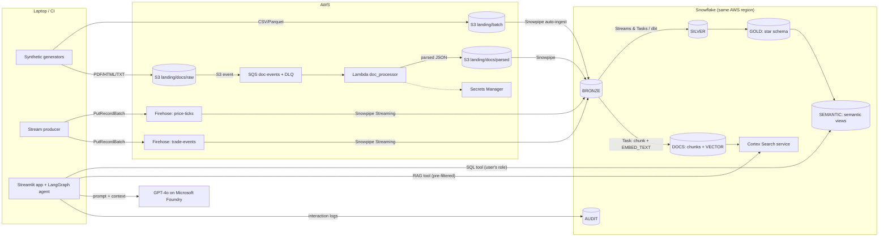
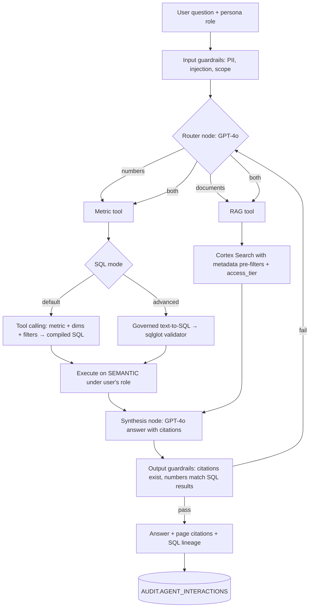

# Architecture

> **MVP note (2026-11-18, updated 2026-11-22):** the build follows [ADR-0012](adr/0012-three-day-zero-cost-mvp.md): Cortex `AI_COMPLETE` instead of Foundry GPT-4o, S3 micro-batch files instead of Firehose, local document parsing instead of Lambda, no CI. Streamlit in Snowflake now runs one app per persona; on a Standard-edition account PII governance uses a secure view instead of masking / row access policies. This document describes the full target design.

## 1. Overview



Three ingestion styles, one medallion warehouse, one agent-powered app:

| Style | Data | Path | Latency |
|---|---|---|---|
| **Batch** | Reference data, custodian holdings | S3 → Snowpipe auto-ingest | Minutes after file lands (files land nightly) |
| **Streaming** | Price ticks, trade events | Firehose → Snowpipe Streaming | Seconds |
| **Event-driven** | Documents (PDF / HTML / TXT) | S3 event → SQS → Lambda → S3 → Snowpipe → Task | About 1 minute per document |

### Medallion layers

| Layer | Snowflake schema | Contents | Built by |
|---|---|---|---|
| **Bronze** | `BRONZE` | Landed as-is: `VARIANT` JSON, raw CSV/Parquet columns, load metadata (file name, row number, ingest time) | Snowpipe, Firehose |
| **Silver** | `SILVER` | Parsed (`LATERAL FLATTEN`), typed, deduplicated (`QUALIFY ROW_NUMBER()`), schema-checked; plus intermediate business logic | Streams & Tasks, dbt |
| **Gold** | `GOLD` | Kimball star schema: SCD2 dimensions and facts | Hand-written MERGE Tasks + dbt |
| **Semantic** | `SEMANTIC` | Snowflake semantic views: governed metrics for BI and AI | Migrations / dbt |

Supporting schemas: `DOCS`, `SNAPSHOTS`, `QUARANTINE`, `AUDIT`, `GOVERNANCE`.

---

## 2. AWS design

### 2.1 S3 landing bucket

One bucket per environment: `alphalake-landing-<account_id>-<env>` (versioning on, SSE-S3 encryption, public access blocked, lifecycle rules).

```
batch/
  securities/dt=2026-11-18/securities_20261118.csv
  funds/ fund_managers/ clients/ accounts/ benchmarks/ fund_flows/
  holdings/dt=2026-11-18/holdings_20261118.parquet
docs/
  raw/<doc_type>/<doc_id>.pdf|html|txt          ← drop zone (triggers Lambda)
  parsed/<doc_type>/<doc_id>_<sha256>.json      ← Lambda output (triggers Snowpipe)
  quarantine/<doc_id>.*                         ← failed validation
stream-errors/                                   ← Firehose delivery failures
```

**Gotcha you'll learn:** S3 doesn't allow two event notifications with overlapping prefix + event type. `batch/` and `docs/parsed/` notify **Snowflake's SQS queue** (Snowpipe); `docs/raw/` notifies **our SQS queue** (Lambda). Prefixes must not overlap (ADR-0004).

Lifecycle: `docs/raw` → Glacier Instant Retrieval after 90 days; `stream-errors` expire after 30 days.

**No hard-coded AWS keys anywhere:** Snowflake reads S3 through a storage integration that assumes an IAM role; Lambda and Firehose use execution roles; CI uses GitHub OIDC.

### 2.2 Streaming: Kinesis Data Firehose

| Stream | Source record | Destination table |
|---|---|---|
| `alphalake-<env>-price-ticks` | `{"security_id","symbol","price","bid","ask","volume","event_ts","source"}` | `BRONZE.PRICE_TICKS_RAW` |
| `alphalake-<env>-trade-events` | Nested trade lifecycle event (see data-model.md) | `BRONZE.TRADE_EVENTS_RAW` |

- Destination: **Snowflake** (native Firehose destination, which uses Snowpipe Streaming internally).
- Auth: key-pair for the `SVC_FIREHOSE` user; the private key is in Secrets Manager.
- Failed records go to `s3://…/stream-errors/`.
- Payloads land in a `VARIANT` column. All parsing happens in Silver (ELT, not ETL).

### 2.3 Event-driven: document pipeline

```mermaid
sequenceDiagram
    participant U as Generator / user
    participant S3 as S3 docs/raw
    participant Q as SQS doc-events
    participant L as Lambda doc_processor
    participant P as S3 docs/parsed
    participant SF as Snowflake

    U->>S3: PUT prospectus_GTIF.pdf
    S3->>Q: ObjectCreated event
    Q->>L: batch of messages
    L->>L: Pydantic-validate event; check type, size
    L->>L: SHA-256 → unchanged since last version? skip (idempotent)
    L->>L: layout-aware parse (PyMuPDF): text blocks + tables → markdown
    L->>L: PII detection + redaction
    L->>P: PUT parsed JSON (Pydantic ParsedDocument model)
    P->>SF: Snowpipe → BRONZE.DOC_PARSED_RAW
    SF->>SF: Stream → Task (one transaction): delete stale chunks of old version → chunk → EMBED_TEXT_1024 → insert DOCS.DOC_CHUNKS
    SF->>SF: Cortex Search service refreshes (target lag)
```

**Lambda engineering standards**

| Concern | Approach |
|---|---|
| Validation | Pydantic models for the S3 event, document metadata, and the parsed output (`ParsedDocument`, `PageBlock`, `TableBlock`) |
| Parsing | **PyMuPDF**: reading-order text blocks, headings detected by font size, `find_tables()` → tables rendered as markdown so the numbers stay aligned. HTML via BeautifulSoup, TXT as-is |
| Incremental sync | SHA-256 of the file bytes. Same hash = skip; new hash = new version, so downstream **deletes old chunks** and inserts new ones |
| PII | Regex + checksum detectors (email, phone, SSN/tax ID, account numbers); replaced with typed tokens such as `[EMAIL_1]`. Runs **before** anything reaches Snowflake |
| Resilience | SQS visibility-timeout retries, DLQ after 3 receives, partial batch failure reporting (`batchItemFailures`), structured JSON logs |
| Packaging | Zip build with manylinux wheels (PyMuPDF fits within Lambda limits). The same `alphalake.docs` package is used by Lambda and by the local backfill CLI |

**Backfill / re-index CLI** (`make reindex`): processes a whole prefix locally with **asyncio** (bounded concurrency via a semaphore), **exponential backoff with jitter** on S3 and Snowflake calls, and the same Pydantic models and parsers. Use it when chunking or the embedding model changes.

### 2.4 IAM (least privilege)

| Principal | Permissions |
|---|---|
| `alphalake-<env>-snowflake-s3-role` | Assumed by Snowflake's IAM user (storage integration, external ID trust). `s3:GetObject`, `s3:ListBucket` on `batch/*` and `docs/parsed/*` only |
| `alphalake-<env>-lambda-doc-role` | Read `docs/raw/*`; write `docs/parsed/*` and `docs/quarantine/*`; consume SQS; CloudWatch logs |
| `alphalake-<env>-firehose-role` | Read its Secrets Manager secret; write `stream-errors/*` |
| `alphalake-ci-role` | Assumed by GitHub Actions via OIDC; scoped to Terraform state and plan |
| Developer (you) | Admin via SSO profile, for `terraform apply` |

---

## 3. Snowflake design

### 3.1 Account-level objects (Terraform)

**Databases:** `ALPHALAKE_DEV`, `ALPHALAKE_PROD`. CI builds run in `ALPHALAKE_CI_<pr>`, a **zero-copy clone** of PROD.

**Schemas (per database):**

| Schema | Purpose | Written by |
|---|---|---|
| `BRONZE` | Raw landed data + load metadata | Snowpipe, Firehose |
| `SILVER` | Parsed, typed, deduped, conformed; `int_*` intermediate models | Streams & Tasks, dbt |
| `GOLD` | Star schema (dims + facts) | MERGE Tasks, dbt |
| `SEMANTIC` | Semantic views (governed metrics) | Migrations / dbt |
| `DOCS` | Documents, chunks, embeddings, Cortex Search service | Tasks |
| `SNAPSHOTS` | dbt SCD2 snapshots | dbt |
| `QUARANTINE` | Records failing schema or quality checks, with reasons | Tasks / dbt |
| `AUDIT` | Pipeline runs, dbt artifacts, agent/LLM interaction logs, eval results | All |
| `GOVERNANCE` | Masking / row access policies, tags, entitlement mapping tables | Migrations |

**Warehouses** (all X-Small, `AUTO_SUSPEND = 60`, `AUTO_RESUME = TRUE`), separated for cost attribution:

| Warehouse | Used by |
|---|---|
| `WH_LOAD` | Ingestion / CDC tasks |
| `WH_TRANSFORM` | dbt, SCD2 MERGE tasks |
| `WH_APP` | Streamlit, agent queries |

Cortex Search uses its own serverless compute.

**Resource monitors:** account-level monthly quota (for example 50 credits), notify at 50% and 75%, suspend at 100%. One monitor per warehouse.

**Integrations:**
- `S3_INT_<ENV>`: storage integration ↔ IAM role (external ID trust), plus an external stage per prefix
- `FOUNDRY_ACCESS_INT`: network rule + secret + external access integration, so Streamlit in Snowflake can call GPT-4o (Phase 8)

### 3.2 RBAC model (access roles + functional roles)

```
ACCOUNTADMIN
 ├── SYSADMIN ── owns databases, warehouses
 └── SECURITYADMIN ── manages grants
       Functional roles (personas)      Access roles (per DB)
       ───────────────────────────      ─────────────────────
       ALPHALAKE_LOADER          ──▶   AR_<DB>_BRONZE_RW
       ALPHALAKE_TRANSFORMER     ──▶   AR_<DB>_BRONZE_R, AR_<DB>_SILVER_RW, AR_<DB>_GOLD_RW
       ANALYST_RESTRICTED        ──▶   AR_<DB>_SEMANTIC_R           (PII masked, PUBLIC+INTERNAL docs)
       ADVISOR                   ──▶   AR_<DB>_SEMANTIC_R           (row access: own clients only)
       PORTFOLIO_ADMIN           ──▶   AR_<DB>_GOLD_R, AR_<DB>_SEMANTIC_R (PII partially masked)
       COMPLIANCE_OFFICER        ──▶   AR_<DB>_GOLD_R, AR_<DB>_SEMANTIC_R (PII unmasked, RESTRICTED docs)
       ALPHALAKE_AI_APP          ──▶   AR_<DB>_DOCS_R, AR_<DB>_AUDIT_RW; can assume persona roles
```

**Service users** (key-pair auth, `TYPE = SERVICE`, no passwords): `SVC_FIREHOSE`, `SVC_DBT`, `SVC_APP`. Your human user uses MFA.

**The agent inherits the user's role.** The app authenticates as `SVC_APP` but runs every agent query under the signed-in persona's role (`USE ROLE <persona>`, secondary roles off). Masking, row access, and document filters therefore apply to the AI exactly as they would to that person in Snowsight. The AI can never see more than its user. For Streamlit in Snowflake, the equivalent mechanism is evaluated in Phase 8.

### 3.3 Schema objects (schemachange migrations)

- Bronze tables, file formats, external stages, pipes (`AUTO_INGEST = TRUE`)
- Streams + Tasks (task graph with a root schedule; `WHEN SYSTEM$STREAM_HAS_DATA`)
- Hand-written SCD2 MERGE procedures (§3.5)
- Dynamic Table `SILVER.DT_LATEST_PRICES` (target lag 1 minute)
- Masking / row access policies, tags

### 3.4 Bronze → Silver: CDC with Streams & Tasks

| Flow | Mechanism | SQL techniques |
|---|---|---|
| `BRONZE.TRADE_EVENTS_RAW` → `SILVER.TRADE_EVENTS` | Stream + Task (every 2 min) | Parse `VARIANT`; `LATERAL FLATTEN(fills)` → `SILVER.TRADE_FILLS`; schema checks route bad rows to `QUARANTINE`; dedupe with `QUALIFY ROW_NUMBER() OVER (PARTITION BY event_id ORDER BY ingest_ts) = 1` |
| `SILVER.TRADE_EVENTS` → `SILVER.TRADES_CURRENT` | Same task graph (child task) | `MERGE` latest state per `trade_id` by `event_seq` (handles late, out-of-order, CORRECTED, and CANCELLED events) |
| `BRONZE.PRICE_TICKS_RAW` → latest price per symbol | **Dynamic Table** | Declarative alternative, compared with Streams & Tasks for cost and latency |
| `BRONZE.DOC_PARSED_RAW` → `DOCS.DOC_CHUNKS` | Stream + Task calling Cortex | Delete-then-insert per document version in one transaction |
| Silver → Gold facts | dbt incremental models (nightly + on demand) | `merge` incremental strategy |

### 3.5 Silver → Gold: SCD2 (two ways, deliberately)

| Dimension | Method | Why |
|---|---|---|
| `DIM_SECURITY`, `DIM_FUND_MANAGER` | **Hand-written idempotent `MERGE`** in a stored procedure called by a Task | Learn the core SQL: detect changes via a hash of tracked attributes, expire the current row (`valid_to`, `is_current = FALSE`), insert the new version. Re-running with the same input changes nothing |
| `DIM_FUND`, `DIM_CLIENT` | **dbt snapshots** (`check` strategy) | Learn the framework approach, then compare it with the hand-written one |

SCD2 columns are the same either way: surrogate key, natural key, `valid_from`, `valid_to` (`9999-12-31` for current), `is_current`, `record_hash`.

### 3.6 Governance

| Control | Implementation |
|---|---|
| Column security (PII masking) | Tag `PII_TYPE` (`EMAIL`, `PHONE`, `NAME`, `DOB`, `TAX_ID`) + **tag-based dynamic masking policy**: unmasked for `COMPLIANCE_OFFICER`, partial for `PORTFOLIO_ADMIN` / `ADVISOR`, fully masked for `ANALYST_RESTRICTED` |
| Row security | Row access policy on `DIM_CLIENT` and client facts using `GOVERNANCE.ADVISOR_CLIENT_MAP`: each advisor sees only their clients |
| Document security | Each chunk has `access_tier` (`PUBLIC` / `INTERNAL` / `RESTRICTED`); retrieval **pre-filters** by the caller's role |
| PII in documents | Redacted in Lambda before embedding |
| Lineage / audit | `ACCOUNT_USAGE.ACCESS_HISTORY`, the dbt docs lineage graph, SQL lineage on every agent answer |

---

## 4. Transformation (dbt)

- dbt owns Silver models not covered by Tasks, the `int_*` models, Gold facts, `DIM_FUND` / `DIM_CLIENT` snapshots, and tests. The hand-written SCD2 dims and Task-built Silver tables are declared as dbt **sources**, so lineage stays complete.
- Materializations: Silver = views or incremental; heavy facts = incremental (`merge`); dims = tables.
- Tests: generic (`unique`, `not_null`, `relationships`, `accepted_values`), `dbt_utils` / `dbt_expectations`, plus custom singular tests:
  - holdings reconcile to cumulative trades (tolerance-based)
  - portfolio weights sum to about 100% per fund-day
  - no future-dated trades; settle date ≥ trade date
  - ISIN check digit validity
  - **SCD2 integrity:** no overlapping validity windows, exactly one current row per natural key
  - **point-in-time:** historical sector exposure uses the sector valid on that date
- Source freshness checks on Bronze tables.
- `dbt docs` for lineage and the data dictionary. Artifacts go to `AUDIT.DBT_RUNS`.

---

## 5. Semantic layer

1. **Snowflake semantic views** (`CREATE SEMANTIC VIEW`) in `SEMANTIC`: tables, relationships, dimensions, facts, and metrics (`net_asset_value`, `aum`, `daily_pnl`, `sector_exposure_pct`, `turnover_ratio`, `net_flows`, and more; see data-model.md §4).
2. **Metric registry** (`semantic/metrics.yml`): mirrors the semantic views with descriptions, synonyms, allowed dimensions, and filters. It feeds the agent's tool schemas and the SQL validator.

Streamlit dashboards and the AI agent both query **only** the semantic layer, so a metric is calculated the same way everywhere. **Why not dbt MetricFlow:** its query APIs need dbt Cloud; semantic views are native and free (ADR-0007).

---

## 6. GenAI: unstructured pipeline and agent

### 6.1 Ingestion side

| Step | Detail |
|---|---|
| Parse | Lambda + PyMuPDF: text blocks in reading order, headings, **tables → markdown** |
| Chunk | Layout-aware: split on sections; ~500 tokens with ~60 overlap; **tables kept whole** as their own chunks; each chunk keeps section title and page number |
| Metadata | `doc_id`, `version`, `sha256`, `doc_type`, `fund_ticker`, `security_id`, `issuer_id`, `quarter`, `asset_class`, `publish_date`, `access_tier`, `page_number`, `embedding_model` |
| Embed | `SNOWFLAKE.CORTEX.EMBED_TEXT_1024('snowflake-arctic-embed-l-v2.0', chunk_text)` → `VECTOR(FLOAT, 1024)` |
| Index | **Cortex Search service** (hybrid vector + BM25 lexical) with attribute filters on fund_ticker, doc_type, quarter, asset_class, access_tier |
| Sync | New SHA-256 means the old version's chunks are deleted in the same transaction, so stale vectors are never searchable |

Raw `VECTOR` columns are kept as well, so you can write manual `VECTOR_COSINE_SIMILARITY` retrieval and compare it with Cortex Search.

### 6.2 Query side: LangGraph research agent



**Metric tool, two modes (ADR-0007):**

| Mode | How it works | Safety |
|---|---|---|
| **Default: tool calling** | GPT-4o fills a structured request `{metric, dimensions, filters, time_range}` validated by Pydantic against `metrics.yml`; Python compiles deterministic SQL | Fully testable; the LLM can only pick from governed metrics |
| **Advanced: governed text-to-SQL** | GPT-4o writes SQL against semantic views, given their definitions | `sqlglot` parses it: must be a single `SELECT`, may reference only `SEMANTIC.*` objects, no DDL/DML, row limit enforced; runs under the user's read-only role |

The eval harness compares the two modes' accuracy on the same golden questions.

**RAG tool:** Cortex Search with **metadata pre-filtering** (for example `fund_ticker = 'GTIF' AND quarter = '2026-Q3'`) extracted by the router, plus a mandatory `access_tier` filter from the user's role.

**Agent implementation:**
- **LangGraph** state graph; GPT-4o via `langchain-openai` `AzureChatOpenAI` (Foundry endpoint, API key)
- A `LLMProvider` abstraction still exists, so Cortex `COMPLETE` can be swapped in for comparison
- Bounded loop: at most 2 guardrail retries, then an "I couldn't verify this" answer
- Calls to Foundry and Snowflake use timeouts, plus retries with exponential backoff

**Output contract:** every answer comes with (a) document citations (`doc title, page N, chunk_id`), (b) the exact SQL executed, plus its semantic view and role, and (c) the route taken.

**Prompt-injection defense:** retrieved text is wrapped as untrusted data, and the system prompt forbids following instructions found inside documents. The corpus includes deliberately "poisoned" documents to test this.

### 6.3 Evaluation

The documents are synthetic, so **ground truth is known**. The generator emits `golden_set.jsonl`.

| Metric | How |
|---|---|
| Routing accuracy | Correct tool(s) chosen |
| Retrieval hit@k, MRR | Gold chunk in top-k |
| SQL accuracy (both modes) | Result matches the expected metric query |
| Numeric accuracy | Numbers in the answer match SQL ground truth |
| Faithfulness / groundedness | GPT-4o-as-judge with a rubric |
| Citation correctness | Cited page actually supports the claim |
| Security | Restricted persona cannot get restricted content or unmasked PII through the agent |
| Injection resistance | Poisoned-document questions don't follow embedded instructions |

Results go to `AUDIT.EVAL_RESULTS` and are shown on a trend page in Streamlit.

---

## 7. Streamlit app

| Page | Content |
|---|---|
| Overview | NAV, AUM, flows, returns by fund (semantic layer) |
| Fund detail | Holdings, sector exposure vs benchmark, compliance status vs mandate limits |
| Live market | Latest prices from the Dynamic Table (auto-refresh) |
| Ask AlphaLake | Agent chat: answer, page citations, SQL lineage, route; SQL-mode toggle; feedback buttons |
| Data quality | dbt test results, freshness, quarantine counts, recon breaks |
| Pipeline & cost | Pipe/task history, credit usage, LLM token spend |
| Eval | Evaluation trends |

A **persona switcher** (Analyst-Restricted / Advisor / Portfolio Admin / Compliance) shows masking, row access, and document tiers changing the same answer.

Hosting: local first (`snowflake-connector-python` with key-pair auth), then **Streamlit in Snowflake** (ADR-0010).

---

## 8. Orchestration

| What | How |
|---|---|
| Streaming CDC, SCD2 MERGE, doc embedding | Snowflake task graphs |
| Nightly batch generation + upload | GitHub Actions cron (or `make` locally) |
| Nightly `dbt build` (prod) | GitHub Actions cron with `SVC_DBT` |
| PR validation | GitHub Actions: ruff + pytest → zero-copy clone PROD → `dbt build --select state:modified+` → drop clone |
| Optional | Local Airflow DAG mirroring the same steps (learning only) |

---

## 9. Observability and cost

| Signal | Source |
|---|---|
| Load health | `COPY_HISTORY`, `PIPE_USAGE_HISTORY`, Firehose CloudWatch metrics |
| Task health | `TASK_HISTORY` → alert on failures |
| Lambda health | CloudWatch logs and metrics, DLQ depth alarm |
| Transformation | `AUDIT.DBT_RUNS`, test failure counts |
| Cost | `WAREHOUSE_METERING_HISTORY`, `CORTEX_FUNCTIONS_USAGE_HISTORY`, resource monitors, AWS Budgets ($10/month alert) |
| Agent | `AUDIT.AGENT_INTERACTIONS`: route, SQL, chunk IDs, tokens, latency, estimated cost, guardrail outcomes, feedback |

**Teardown:** `make destroy ENV=dev` suspends tasks, then runs `terraform destroy`.

---

## 10. Python engineering standards

| Area | Standard |
|---|---|
| Packaging | Single `alphalake` package (src layout), Python 3.12, `uv` for dependencies |
| Data contracts | Pydantic v2 models for every event, file, document, and tool input/output |
| Concurrency | asyncio with bounded semaphores for backfill, re-embedding, and eval runs |
| Resilience | Timeouts everywhere; exponential backoff with jitter on network calls; idempotent writes |
| Config | `pydantic-settings`: env vars → `.env` (local, git-ignored) → defaults |
| Logging | Structured JSON logs with run_id / correlation_id |
| Quality | ruff (lint + format), mypy on core modules, pytest (unit + integration markers), pre-commit |
| Secrets | Never in git: `.env` locally, Secrets Manager (AWS), Snowflake `SECRET` (SiS), GitHub encrypted secrets (CI) |

---

## 11. Environments

`dev` is your sandbox; `prod` is the scheduled environment. Same code, different tfvars and `.env`. CI uses throwaway zero-copy clones.
