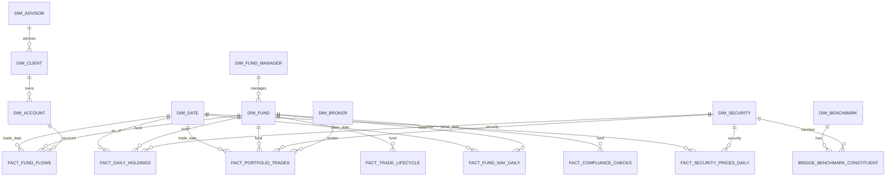

# Data Model

## 1. Fictional company: Northwind Capital

- 12 mutual funds across equity, fixed income, and multi-asset strategies
- ~1,500 tradable securities, 5,000 clients, 8,000 accounts, 25 advisors, 8 fund managers
- 3 years of history (2024-01-01 → generation date), plus live streaming going forward

| Fund ticker | Fund name | Strategy | Benchmark | Key prospectus limits |
|---|---|---|---|---|
| GTIF | Global Tech Innovation Fund | Equity – sector | MSCI ACWI IT (synthetic) | Max single issuer 8%, max semiconductor sub-industry 35% |
| EUTF | European Tech Fund | Equity – regional sector | MSCI Europe IT | Max single issuer 8%, min 80% European domicile |
| USLG | US Large Cap Growth | Equity | S&P 500 Growth (synthetic) | Max single issuer 10%, max sector 40% |
| USLV | US Large Cap Value | Equity | S&P 500 Value | Max single issuer 10% |
| ESGL | ESG Leaders Fund | Equity – ESG | MSCI World ESG | No tobacco/weapons, min ESG score 60 |
| EMEQ | Emerging Markets Equity | Equity | MSCI EM | Max country 30% |
| DIVI | Dividend Income Fund | Equity income | Dividend index | Min portfolio dividend yield 2.5% |
| GBND | Global Bond Fund | Fixed income | Global Agg | Min avg rating A-, max high yield 10% |
| HYLD | High Yield Bond Fund | Fixed income | HY index | Max single issuer 3% |
| MUNI | Municipal Bond Fund | Fixed income | Muni index | Min 80% muni bonds |
| BAL6 | Balanced 60/40 Fund | Multi-asset | 60/40 blend | Equity 50–70%, bonds 30–50% |
| MMKT | Money Market Fund | Cash | T-bill | WAM ≤ 60 days |

The limits **appear in both** the `fund_mandate_limits` table (structured) **and** the prospectus PDFs (unstructured), so the compliance check and the agent can cross-verify them. A few funds are deliberately generated **in breach** on some dates.

---

## 2. Source entities (Bronze layer)

### 2.1 Batch: reference data (CSV, nightly full or delta)

| Entity → Bronze table | Key columns | Notes |
|---|---|---|
| `securities` → `BRONZE.SECURITIES_RAW` | security_id, ticker, isin, cusip, name, asset_class, gics_sector, gics_industry, gics_sub_industry, country, currency, issuer_id, coupon, maturity_date, credit_rating, esg_score, is_active, updated_at | **SCD2 source** (hand-written MERGE): ratings, sector reclassification, name changes, ESG score |
| `issuers` → `BRONZE.ISSUERS_RAW` | issuer_id, issuer_name, country, parent_issuer_id | Parent hierarchy for issuer-concentration checks |
| `fund_managers` → `BRONZE.FUND_MANAGERS_RAW` | manager_id, name, email, phone, title, team, region, hire_date, updated_at | **SCD2 source** (hand-written MERGE): title/team changes; PII columns |
| `funds` → `BRONZE.FUNDS_RAW` | fund_id, fund_ticker, fund_name, strategy, asset_class, region, base_currency, inception_date, expense_ratio, benchmark_id, manager_id, updated_at | SCD2 via dbt snapshot: manager changes |
| `fund_mandate_limits` | fund_id, limit_type, dimension, dimension_value, min_pct, max_pct, effective_from | |
| `benchmarks`, `benchmark_constituents` | benchmark_id, security_id, weight, as_of_date | Monthly rebalance |
| `advisors` | advisor_id, name, email, region, hire_date | PII |
| `clients` → `BRONZE.CLIENTS_RAW` | client_id, first_name, last_name, email, phone, dob, tax_id, country, state, segment (Retail/HNW/Institutional), risk_profile, kyc_status, advisor_id, updated_at | **PII**; SCD2 via dbt snapshot (risk_profile / segment / advisor) |
| `accounts` | account_id, client_id, account_type (Taxable/IRA/Roth/Trust/Institutional), open_date, close_date, status | |
| `fund_flows` | flow_id, account_id, fund_id, flow_type (SUBSCRIPTION/REDEMPTION/SWITCH), amount, units, nav_price, trade_date | Client money in and out |
| `fx_rates` | currency_pair, rate_date, rate | Daily |
| `eod_prices` | security_id, price_date, open, high, low, close, volume, source | Historical backfill; live prices come from the tick stream |

### 2.2 Batch: custodian holdings (Parquet, nightly)

| Column | Notes |
|---|---|
| as_of_date, fund_id, security_id, quantity, market_value_local, currency, custodian | Independent "source of truth" from the custodian |

Used to **reconcile** against positions derived from trades (a classic asset-management control).

### 2.3 Streaming: trade events (nested JSON via Firehose → `BRONZE.TRADE_EVENTS_RAW`)

```json
{
  "event_id": "e-7f3a…",
  "event_type": "FILLED",              // NEW | PARTIALLY_FILLED | FILLED | CORRECTED | CANCELLED | SETTLED
  "event_seq": 3,
  "event_ts": "2026-11-18T14:32:05.120Z",
  "trade": {
    "trade_id": "T-20261118-000123",
    "fund_id": "GTIF",
    "security": {"security_id": "SEC-00042", "ticker": "NVDX", "isin": "US0000000421"},
    "side": "BUY",
    "order_qty": 25000,
    "limit_price": 141.20,
    "currency": "USD",
    "broker": {"broker_id": "BRK-03", "name": "Fictional Securities LLC"},
    "trader_id": "TR-07"
  },
  "fills": [
    {"fill_id": "F1", "qty": 10000, "price": 141.05, "venue": "XNAS", "ts": "…"},
    {"fill_id": "F2", "qty": 15000, "price": 141.10, "venue": "ARCX", "ts": "…"}
  ],
  "fees": {"commission": 125.00, "sec_fee": 3.20},
  "settlement": {"settle_date": "2026-11-19", "custodian": "Fictional Trust Co"},
  "schema_version": "1.1"
}
```

Silver parsing: top-level fields → `SILVER.TRADE_EVENTS`; `LATERAL FLATTEN(input => payload:fills)` → `SILVER.TRADE_FILLS` (one row per fill).

### 2.4 Streaming: price ticks (JSON via Firehose → `BRONZE.PRICE_TICKS_RAW`)

```json
{"security_id":"SEC-00042","symbol":"NVDX","price":141.12,"bid":141.11,"ask":141.13,
 "volume":300,"event_ts":"2026-11-18T14:32:05.250Z","source":"SIM-FEED"}
```

Prices follow a geometric Brownian motion per security, with sector correlation, so returns look realistic.

### 2.5 Deliberate data-quality problems (for learning)

| Problem | Where | What should catch or fix it |
|---|---|---|
| Duplicate events (at-least-once delivery) | trade events, ticks | `QUALIFY ROW_NUMBER() OVER (PARTITION BY event_id …) = 1` |
| Out-of-order and late-arriving events | trade events | MERGE by `event_seq`; late events update facts |
| Trade corrections and cancels | trade events | `CORRECTED` / `CANCELLED` handling in `TRADES_CURRENT` |
| Schema drift (v1.0 → v1.1 adds `fees.sec_fee`) | trade events | `VARIANT` + tolerant Silver parsing; drift logged |
| Malformed payload (missing `trade_id`, bad types) | trade events | Schema check → `QUARANTINE.TRADE_EVENTS` with reason |
| Invalid ISIN check digit | securities | Custom test → `QUARANTINE` |
| Unchanged reference rows re-sent daily | securities, fund_managers | Hash comparison in SCD2 MERGE (no new version created) |
| Missing prices for a day | eod_prices | Forward-fill in `int_` model + freshness alert |
| Holdings ≠ trade-derived positions | holdings | Reconciliation test and breaks report |
| Duplicate file re-upload | batch, docs | Snowpipe load metadata / SHA-256 sync |
| Negative quantity / future trade date | trades | dbt tests |

---

## 3. Dimensional model (GOLD)

### 3.1 Star schema



### 3.2 Dimensions

| Dimension | Type | Built by | Notes |
|---|---|---|---|
| `DIM_DATE` | Static | dbt | is_trading_day, quarter, fiscal periods, month-end flags |
| `DIM_SECURITY` | **SCD2** | **Hand-written MERGE** | `security_sk`; tracked: sector/industry, rating, name, ESG score; includes issuer hierarchy |
| `DIM_FUND_MANAGER` | **SCD2** | **Hand-written MERGE** | `manager_sk`; tracked: title, team, region; PII tagged |
| `DIM_FUND` | **SCD2** | dbt snapshot | Tracked: manager, expense ratio, strategy |
| `DIM_CLIENT` | **SCD2** | dbt snapshot | PII tagged; masking + row access policies |
| `DIM_ACCOUNT` | SCD1 | dbt | |
| `DIM_ADVISOR` | SCD1 | dbt | PII tagged |
| `DIM_BROKER` | SCD1 | dbt | Built from trade events (late-arriving dimension → "unknown" member) |
| `DIM_BENCHMARK`, `DIM_CURRENCY` | SCD1 / static | dbt | |

**Hand-written SCD2 MERGE pattern** (idempotent):

1. Compute `record_hash = SHA2(tracked attributes)` for incoming Silver rows.
2. **Expire:** current rows whose hash differs → `valid_to = change_ts`, `is_current = FALSE`.
3. **Insert:** new natural keys plus changed keys (new version with `valid_from = change_ts`, `valid_to = '9999-12-31'`, `is_current = TRUE`).
4. Re-running with identical input produces **zero changes**. A test asserts this.

### 3.3 Facts

| Fact | Type | Grain | Key measures |
|---|---|---|---|
| `FACT_PORTFOLIO_TRADES` | Transaction | **One row per executed trade order** (final state) | quantity, avg_fill_price, gross_amount, commission, fees, net_amount, fill_count |
| `FACT_TRADE_LIFECYCLE` | **Accumulating snapshot** | One row per trade, milestone timestamps | new_ts, first_fill_ts, filled_ts, settled_ts, time_to_fill_sec, is_cancelled |
| `FACT_DAILY_HOLDINGS` | **Periodic snapshot** | fund × security × day | quantity, price, market_value_base, weight_pct, unrealized_pnl, daily_pnl |
| `FACT_SECURITY_PRICES_DAILY` | Periodic snapshot | security × day | open/high/low/close, daily_return, 30d volatility |
| `FACT_FUND_NAV_DAILY` | Periodic snapshot | fund × day | net_asset_value, nav_per_unit, units_outstanding, daily_return, net_flows |
| `FACT_FUND_FLOWS` | Transaction | One row per client flow | amount, units |
| `FACT_COMPLIANCE_CHECKS` | Periodic snapshot | fund × limit × day | actual_pct, limit_pct, is_breach, headroom_pct |
| `FACT_HOLDINGS_RECONCILIATION` | Periodic snapshot | fund × security × day | custodian_qty, derived_qty, break_qty, is_break |
| `BRIDGE_BENCHMARK_CONSTITUENT` | Bridge | benchmark × security × month | weight |

### 3.4 Point-in-time correctness

Facts join to SCD2 dims on `fact_date >= valid_from AND fact_date < valid_to`. For example, sector exposure on 2025-03-31 uses the GICS sector the security had **on that date**, not today's sector. This is a common interview topic, and there's a dedicated test for it.

---

## 4. Semantic layer: metric catalogue

| Metric | Definition | Common dimensions |
|---|---|---|
| `net_asset_value` | `FACT_FUND_NAV_DAILY.net_asset_value` (total fund NAV) | fund, date, region, asset_class |
| `nav_per_unit` | NAV / units outstanding | fund, date |
| `aum` | Σ NAV across funds | fund, asset_class, region, date |
| `daily_pnl` | Σ `daily_pnl` from holdings (price change × quantity, FX-adjusted) | fund, security, sector, date |
| `sector_exposure_pct` | Σ weight_pct by GICS sector (point-in-time) | fund, sector, region, date |
| `active_weight_pct` | fund weight − benchmark weight | fund, sector / security, date |
| `issuer_concentration_pct` | Σ weight by parent issuer | fund, issuer, date |
| `fund_return` | Compounded daily NAV return over a period | fund, period (MTD/QTD/YTD/1Y) |
| `excess_return` | fund_return − benchmark_return | fund, period |
| `net_flows` | subscriptions − redemptions | fund, segment, advisor, period |
| `turnover_ratio` | min(Σ buys, Σ sells) / average NAV over the period | fund, period |
| `trade_count`, `avg_time_to_fill` | From trade facts | fund, broker, date |
| `compliance_breaches` | count of is_breach | fund, limit_type, date |
| `recon_breaks` | count of is_break | fund, date |

Example agent question:

> *"What is our total tech sector exposure across European equity funds this quarter?"*

This compiles to `sector_exposure_pct` with filters `sector = 'Information Technology'`, `region = 'Europe'`, `asset_class = 'Equity'`, `period = current quarter`.

---

## 5. Document corpus (synthetic)

| Doc type | Count | Format | Access tier | Linked to | Purpose |
|---|---|---|---|---|---|
| Fund prospectus | 12 | PDF (multi-page, with fee and limit **tables**) | PUBLIC | fund | Objectives, **limits**, risk factors, fees |
| Fund fact sheet | 48 (quarterly) | PDF (top-holdings and performance **tables**) | PUBLIC | fund, quarter | Numbers cross-check against Gold |
| Quarterly manager commentary | 48 | PDF | PUBLIC | fund, quarter | **Risk factors the manager highlighted** ("What risks did the GTIF manager flag in Q3?") |
| Earnings call transcript | ~120 | TXT / HTML | PUBLIC | security, quarter | Issuer guidance, Q&A (10-Q-style content) |
| Equity research note | ~300 | PDF | INTERNAL | security | Rating, price target, thesis |
| Credit research note | ~80 | PDF | INTERNAL | issuer | Credit view |
| Compliance policy | 8 | PDF | INTERNAL | — | Code of ethics, best execution, trade allocation, personal trading |
| Investment committee minutes | 24 | HTML | RESTRICTED | fund, quarter | Decisions, rationale |
| Client emails | ~200 | TXT | RESTRICTED | client | **Contain PII** → redaction test |
| Poisoned document | 2 | PDF | INTERNAL | — | Hidden prompt-injection text → guardrail test |

Documents are generated from **templates and the structured data**, so every fact is known. Optionally, GPT-4o rewrites template prose so it reads more naturally, with automated fact-preservation checks. The generator writes `golden_set.jsonl` at the same time: question, persona, expected route, expected answer, gold doc/page/chunk, expected metric query.

### DOCS schema

| Table | Grain | Key columns |
|---|---|---|
| `BRONZE.DOC_PARSED_RAW` | One row per document version | doc_id, version, sha256, doc_type, metadata VARIANT, blocks VARIANT (text + tables per page), parsed_at |
| `DOCS.DOCUMENTS` | Current version per document | doc_id, version, sha256, title, doc_type, fund_ticker, security_id, issuer_id, quarter, asset_class, publish_date, access_tier, s3_uri |
| `DOCS.DOC_CHUNKS` | One row per chunk (current versions only) | chunk_id, doc_id, version, chunk_index, chunk_type (text / table), section_title, page_number, chunk_text, token_count, embedding `VECTOR(FLOAT,1024)`, embedding_model, + filter metadata (fund_ticker, doc_type, quarter, asset_class, access_tier) |
| `DOCS.ALPHALAKE_SEARCH` | Cortex Search service | ON chunk_text; ATTRIBUTES fund_ticker, doc_type, quarter, asset_class, access_tier, security_id |
